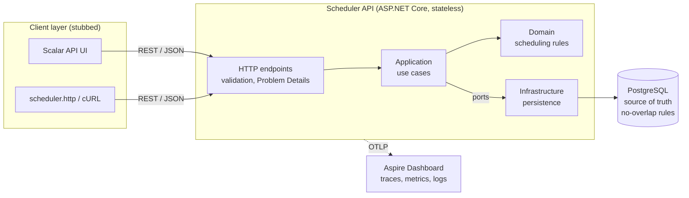
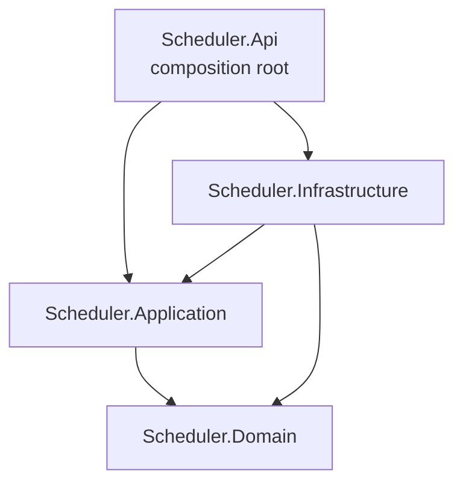
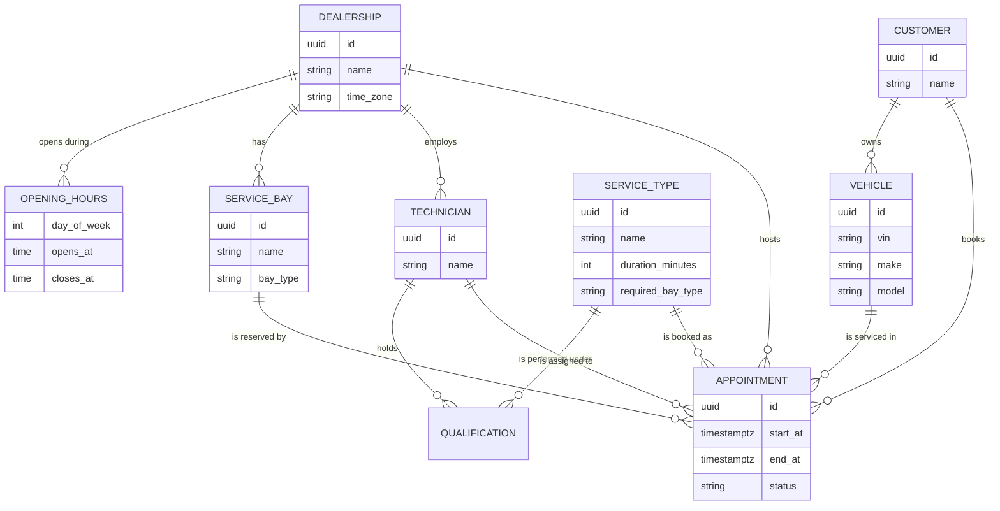
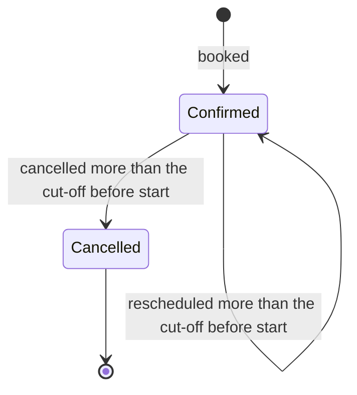
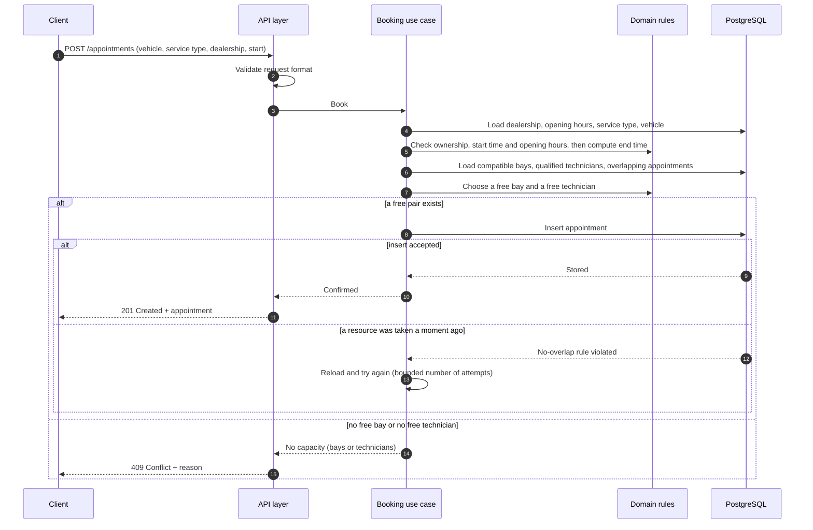
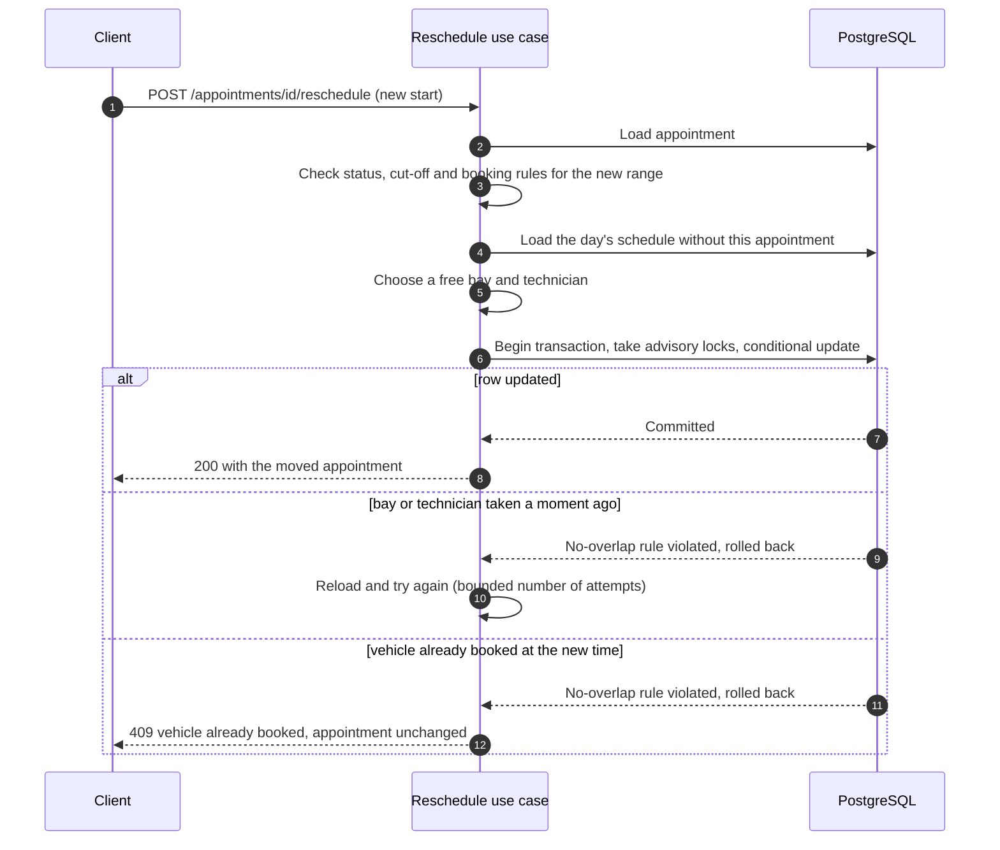
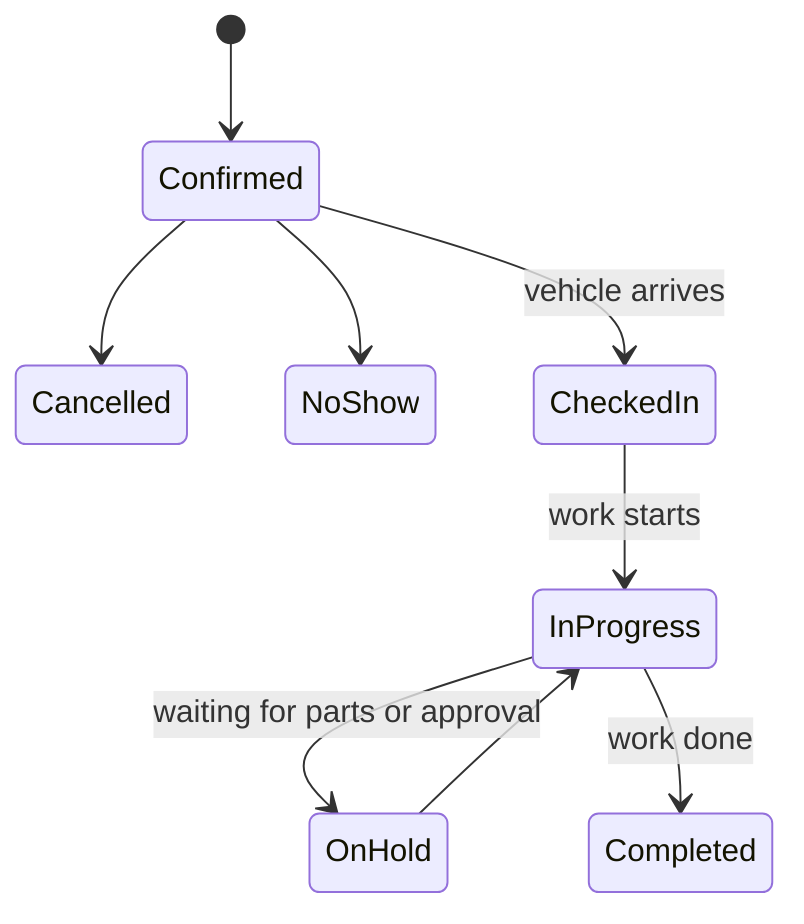

# System Design Document — Unified Service Scheduler

| | |
| --- | --- |
| Scenario | Keyloop Technical Assessment, Scenario A: The Unified Service Scheduler |
| Layer implemented | Backend (REST API + PostgreSQL). The client layer is stubbed. |
| Author | Cu Tiến |
| Status | Draft 0.1, 2026-10-30 |

## Contents

0. [Summary](#0-summary)
1. [Context and problem](#1-context-and-problem)
2. [Scope](#2-scope)
3. [Assumptions](#3-assumptions)
4. [Architecture overview](#4-architecture-overview)
5. [Components](#5-components)
6. [Domain model](#6-domain-model)
7. [Data flow](#7-data-flow)
8. [Preventing double booking](#8-preventing-double-booking)
9. [Technology choices](#9-technology-choices)
10. [Observability](#10-observability)
11. [Quality attributes](#11-quality-attributes)
12. [When reality deviates from the plan](#12-when-reality-deviates-from-the-plan)
13. [Testing strategy](#13-testing-strategy)
14. [Future work](#14-future-work)
15. [How GenAI assisted the design](#15-how-genai-assisted-the-design)

---

## 0. Summary

Dealership service departments still book workshop appointments by phone, paper and spreadsheets. This leads to two cars booked on the same lift, jobs booked when no technician can do them, and customers waiting on arrival.

The Unified Service Scheduler is a backend service that takes a booking request (vehicle, service type, dealership, desired start time) and confirms it only if a **compatible service bay** and a **qualified technician** are both free for the **whole** service duration. A confirmed appointment is stored with the customer, vehicle, technician and bay.

The hard part is not finding a free slot but **keeping it free until it is taken**: two requests can see the same last slot at the same moment. The design makes the database the referee. PostgreSQL refuses to store two active appointments that overlap in time for the same bay, the same technician or the same vehicle, so double booking is impossible even with many API instances running in parallel. The application handles a lost race by trying another free bay and technician, or by returning a clear "fully booked" answer.

The system is a single, stateless ASP.NET Core service with a layered structure, backed by PostgreSQL, instrumented with OpenTelemetry and runnable with one `docker compose` command.

## 1. Context and problem

### 1.1 Business context

A dealership's service department has a fixed set of **service bays** (lifts, alignment bays, EV bays) and a team of **technicians** with different qualifications. Each kind of service takes a known amount of time, needs a certain kind of bay and can only be done by technicians qualified for it. Manual booking cannot see all of these constraints at once, which causes overbooking and idle capacity at the same time.

### 1.2 The core problem

This is a **two-resource scheduling problem**. Every appointment needs two scarce resources at the same time, for the whole duration:

- one **service bay** of the type the service requires, and
- one **technician** qualified for the service.

A slot is bookable only if both exist. A free bay with no free technician, or a free technician with no free bay, is not enough.

### 1.3 Acceptance criteria from the brief

| ID | Requirement |
| --- | --- |
| AC1 | A user can request a service appointment for a specific vehicle, service type and dealership at a desired time. |
| AC2 | Before confirming, the system checks that both a service bay and a qualified technician are available for the entire service duration. |
| AC3 | On success, a persistent appointment record associates the customer, vehicle, technician and service bay. |

### 1.4 Implicit requirements

- **Clear rejection.** When a request cannot be served, the caller learns why: unknown data, a broken business rule, or no capacity at that time.
- **No double booking under concurrency.** "Real-time" availability is only meaningful if it stays correct when several people book at once, including across several API instances.
- **Build for the future.** The design must address scalability, performance, reliability, maintainability and observability (see sections 10 and 11).

## 2. Scope

Only the backend is implemented. The client is stubbed with an interactive OpenAPI UI (Scalar) and a file of ready-to-run HTTP requests, as the brief allows.

| Priority | Capability |
| --- | --- |
| **Must** | Book an appointment with the bay + qualified technician check (AC1–AC3). Read an appointment back. No double booking under concurrent requests. Tests for the core business rules and the concurrency guarantee. Client stub. One-command local run. This document. |
| **Should** | Look up free start times for a dealership, service type and day. Suggest alternative times for an existing appointment. Cancel an appointment, which frees its slot. Reschedule an appointment: move it to another time in one step. A change cut-off: cancelling and rescheduling are allowed only while the appointment starts more than the cut-off from now. Observability working in the demo (logs, metrics, traces). Continuous integration (build and test on every push). |
| **Could** | Idempotent booking: a client that retries the same request does not create two appointments. |
| **Won't (this version)** | Authentication and authorisation, a real user interface, notifications, moving an appointment to another dealership or service, technician shifts and leave, tracking the actual execution of a job (see section 12). |

## 3. Assumptions

The brief is intentionally ambiguous. These assumptions were agreed before design and drive the behaviour of the system.

| ID | Assumption | Reason |
| --- | --- | --- |
| A1 | Callers are a service advisor tool or a customer-facing app. There is no authentication in this version. | Authentication is not part of the acceptance criteria; it is listed as future work. |
| A2 | The "desired time" is an exact start time, not a window. If it cannot be served the request is rejected, and the availability lookup helps the caller pick another time. | Keeps booking deterministic and easy to test. |
| A3 | Each service type has a fixed duration. End time = start time + duration. | The brief speaks of "the entire service duration" without saying where it comes from. |
| A4 | A technician is qualified for a set of service types. Skills and certifications are not modelled separately. | The simplest model that answers "is this technician qualified for this service?". |
| A5 | Each bay has one bay type. Each service type requires one bay type. A bay is compatible when the types match. | Expresses "compatible bay" without a complex capability model. |
| A6 | Technicians work the dealership's opening hours. Individual shifts, breaks and leave are not modelled. An appointment must fit entirely within the opening hours of one local day, in the dealership's time zone. | Keeps availability focused on bookings; shifts are future work. |
| A7 | An appointment uses exactly one bay and one technician for its whole duration. There is no hand-over between technicians and no buffer between appointments; back-to-back appointments are allowed. | Matches the brief's wording and keeps intervals simple. |
| A8 | The start time must be in the future and on a 15-minute grid. | Avoids odd start times and keeps the availability list readable. |
| A9 | Dealerships, bays, technicians, service types, customers and vehicles are reference data seeded at start-up; there is no API to manage them. The vehicle must belong to the customer making the booking. | Managing master data is outside the brief. |
| A10 | When several bays or technicians are free, the first one in a fixed order is chosen. | Deterministic and testable. Load balancing is future work. |
| A11 | Cancelling keeps the record with status Cancelled and frees the slot. Rescheduling moves the appointment to another start time in one atomic step, keeping its id; it is not cancel + book. | Keeps history; a cancelled appointment must not block anyone. With cancel + book the customer could lose the old slot and then find the new one taken; a single step either moves the appointment or leaves it untouched. |
| A12 | Errors: a malformed request is 400, an unknown reference is 404, a broken business rule is 422, and no capacity or a conflict is 409. All errors use the RFC 7807 Problem Details format. | Lets clients tell "fix your request" apart from "try another time". |
| A13 | A vehicle cannot have two overlapping active appointments, even at different dealerships. | A car cannot be in two workshops at once. Not stated in the brief, but required for data to make sense. |
| A14 | An appointment can be cancelled or rescheduled only while it starts more than the change cut-off from now (configurable, default 2 hours). Cancelling an already cancelled appointment returns its current state. | The workshop needs time to react, and started appointments must not be rewritten. Making cancel return the current state makes it safe to retry. |
| A15 | The availability lookup takes a date in the dealership's local calendar. Past dates return no slots. | Customers think in local days. |
| A16 | Idempotency keys are global because there is no client identity yet. Clients should use UUIDs. | Becomes per-client once authentication exists. |
| A17 | Bays and technicians are independent pools within a dealership: any technician can work in any bay. | The brief treats them as separate resources. Some workshops assign a technician to a fixed lift; that would be a different model. |

## 4. Architecture overview

### 4.1 System context



### 4.2 Why a single layered service

The system is one deployable service (a modular monolith) with four layers inside it. Microservices were considered and rejected for this problem:

- Booking needs the bays, technicians and existing appointments of one dealership **in one consistent view**. Splitting them into separate services would turn a single database guarantee into a distributed consistency problem.
- There is one team, one domain and one data store; extra services would add network calls, deployment work and failure modes without a benefit.
- The service is **stateless**: all state lives in PostgreSQL. To handle more load, more instances are started behind a load balancer. Correctness does not depend on how many instances run (section 8).

The layers keep the business rules independent of HTTP and the database, so they can be tested in isolation and the delivery or storage technology can change without rewriting them.

### 4.3 Layer dependencies

Dependencies point inward. The domain depends on nothing; the application layer defines the persistence ports it needs, and the infrastructure layer implements them.



### 4.4 Deployment

**Local and demo.** Docker Compose starts three containers: the API, PostgreSQL and the Aspire Dashboard. By default the API listens on host port 8080 (`API_PORT`) and the dashboard on 18888 (`DASHBOARD_PORT`). On start-up the API applies database migrations and seeds sample data, so a reviewer can call it immediately.

**Target production shape.** Several API containers behind a load balancer (for example AWS ECS or EKS behind an Application Load Balancer), a managed PostgreSQL with high availability (Amazon RDS or Aurora, multi-AZ), and an OpenTelemetry Collector forwarding telemetry to the organisation's monitoring backend. Migrations run as a separate step in the delivery pipeline rather than at application start-up. No code changes are needed to move from the local shape to this one.

## 5. Components

| Component | Responsibility | Does not |
| --- | --- | --- |
| **Client stub** (Scalar UI, `http/scheduler.http`) | Lets a reviewer or integrator call every endpoint and see the contract. | Contain business logic. |
| **API layer** (`Scheduler.Api`) | HTTP endpoints; request validation; mapping use-case outcomes to HTTP status codes and Problem Details; OpenAPI document; telemetry set-up; wiring of all components. | Make business decisions. |
| **Application layer** (`Scheduler.Application`) | Use cases: book, get, cancel, reschedule, availability, alternatives. Loads what a decision needs, asks the domain to decide, persists the result, and retries when another request took the chosen resource. Defines the persistence ports. | Know about HTTP, SQL or the database driver. |
| **Domain layer** (`Scheduler.Domain`) | Business concepts and rules: time ranges and overlap, opening hours in local time, technician qualification, bay compatibility, choosing a free bay and technician, the appointment lifecycle. | Depend on any framework or library. |
| **Infrastructure layer** (`Scheduler.Infrastructure`) | Persistence with EF Core; schema migrations including the no-overlap rules; seed data; translating a database rule violation into a domain outcome ("bay taken", "technician taken", "vehicle already booked"). | Make business decisions. |
| **PostgreSQL** | Source of truth for all data. Enforces that active appointments never overlap for the same bay, technician or vehicle. | — |
| **Aspire Dashboard** | Receives traces, metrics and logs over OTLP for local inspection and the demo. | Persist telemetry long term (it is a development tool). |

## 6. Domain model

### 6.1 Concepts

- **Dealership**: a workshop location with weekly opening hours and its own time zone.
- **Service bay**: belongs to one dealership; has a bay type (general, alignment, EV, ...).
- **Technician**: belongs to one dealership; is qualified for a set of service types.
- **Service type**: a kind of job with a fixed duration and a required bay type. Shared by all dealerships.
- **Customer** and **Vehicle**: a vehicle is registered to one customer.
- **Appointment**: links a customer, vehicle, dealership, service type, bay and technician to a time range and a status.



### 6.2 Time

- All instants are stored and compared in **UTC**. Opening hours are interpreted in the dealership's **local time zone**, so they stay correct when the server runs elsewhere and across daylight-saving changes.
- Timestamps sent by clients must carry an explicit UTC offset. A timestamp without one is rejected instead of being guessed from the server's clock.
- Time ranges are **half-open**, `[start, end)`. Two ranges overlap when each starts before the other ends. An appointment ending at 10:00 and another starting at 10:00 do not overlap.

### 6.3 Appointment lifecycle (this version)



Only **Confirmed** appointments occupy resources. The lifecycle is designed to grow (section 12).

## 7. Data flow

### 7.1 API surface

| Method | Path | Purpose | Priority |
| --- | --- | --- | --- |
| POST | `/appointments` | Book an appointment. Optional `Idempotency-Key` header. | Must (header: Could) |
| GET | `/appointments/{id}` | Read an appointment back. | Must |
| GET | `/dealerships/{id}/availability?serviceTypeId=&date=` | List free start times for one local day. | Should |
| GET | `/appointments/{id}/alternatives?date=` | List free start times for an existing appointment on a local day (default: its own day). | Should |
| POST | `/appointments/{id}/reschedule` | Move an appointment to a new start time in one step. | Should |
| POST | `/appointments/{id}/cancel` | Cancel an appointment and free its slot. | Should |

### 7.2 Booking



Step by step:

1. **Validate the request format.** Missing fields or a timestamp without an offset are rejected with **400**.
2. **Load reference data.** Unknown dealership, service type, customer or vehicle gives **404**.
3. **Apply business rules.** The vehicle must belong to the customer; the start must be in the future and on the 15-minute grid; the whole range `[start, start + duration)` must fall within opening hours in the dealership's time zone. A broken rule gives **422**.
4. **Find free resources.** Load the compatible bays and the qualified technicians. If the dealership has no bay of the required type or no technician qualified for the service at all, the answer is **422 service not offered**: this is permanent, so trying another time will not help. Otherwise load the confirmed appointments that overlap the requested range, and the domain picks the first free bay and the first free technician. A resource is free only if it is free for the **entire** range: being free at the start time is not enough.
5. **Store the appointment.** The database accepts it unless another request has just taken the same bay, technician or vehicle (section 8).
6. **Answer.** **201** with the bay, technician and times; or **409** with the reason.

**Example.** A customer wants a 60-minute service from 09:00 to 10:00. The dealership has two general bays and three technicians qualified for the service.

```
                08:00       09:00       10:00       11:00
Bay B1                [==car A===]                      busy 08:30–09:30  → excluded
Bay B2                                                  free              → candidate
Technician T1         [==car A===]                      busy 08:30–09:30  → excluded
Technician T2                     [==car C===]          busy 09:30–10:30  → excluded
Technician T3                                           free              → candidate
Requested                   [==========]                09:00–10:00

Result: book bay B2 with technician T3   (one character = 5 minutes)
```

Technician T2 is free at 09:00 but not for the whole hour, so T2 cannot take the job.

**The four outcomes of the resource check.**

| Free compatible bay? | Free qualified technician? | Result |
| --- | --- | --- |
| Yes | Yes | Book with the chosen pair |
| Yes | No | 409: no technician available at this time |
| No | Yes | 409: no bay available at this time |
| No | No | 409: fully booked at this time |

The rejection names the bottleneck. A customer only needs to know the slot is taken, but the dealership learns whether it is short of technicians or of bays, which is a capacity-planning signal (section 10).

### 7.3 Availability lookup

1. Load the dealership's opening hours for the requested local date, the compatible bays, the qualified technicians and the confirmed appointments of that day.
2. Generate candidate start times every 15 minutes, from opening time to closing time minus the service duration, dropping every start time that is not after the current time.
3. Keep a candidate only if the **same allocator used for booking** finds a free bay and a free technician for its whole range. Availability and booking therefore cannot disagree.
4. Return the free start and end times in UTC, with the dealership's time zone so the client can show local times.

Edge cases: a past date or a day on which the dealership is closed returns **200 with an empty list**, not an error. If the dealership has no compatible bay or no qualified technician at all, the answer is **422 service not offered**, detected once before the candidates are generated and the same answer booking gives. A missing or malformed `date` is **400**; an unknown dealership or service type is **404**.

The result is a snapshot, not a reservation. A booking for a listed time can still be rejected if someone else books it first; the client then refreshes the list.

**Alternatives for an existing appointment.** `GET /appointments/{id}/alternatives?date=` reuses the same calculation with two adjustments: the appointment's own bay, technician and time count as free (so moving it 30 minutes later, which overlaps its current range, is offered), and any start time that overlaps another confirmed appointment of the same vehicle that day is dropped. The date defaults to the appointment's own local date. The change rules apply: a cancelled appointment or one inside the cut-off gives 422.

### 7.4 Cancellation

The status changes from Confirmed to Cancelled and the cancellation time is recorded, in a single conditional update: the row is changed only if it is still Confirmed and starts more than the change cut-off from now (A14). The database row decides, so a cancellation racing with a reschedule or another cancellation cannot both win. If no row was changed, the use case reloads the appointment and answers: not found (404), already cancelled (200 with its current state, so a retry is safe) or too late (422 change window closed).

Because only confirmed appointments occupy resources, cancelled rows never block anyone: the bay, technician and vehicle are free for that range at once.

### 7.5 Rescheduling

Rescheduling moves a confirmed appointment to a new start time in one step. Only the time changes: the dealership, service type, customer and vehicle stay, and the id stays, so references to the appointment remain valid. The bay and technician are chosen again with the booking rule and may differ from before.

1. **Load and check the change rules.** The appointment must be Confirmed (a cancelled one gives 422 appointment cancelled) and must start more than the change cut-off from now (otherwise 422 change window closed).
2. **Check the booking rules for the new range.** The new start must be in the future, on the 15-minute grid and, with the duration, inside opening hours (422 otherwise).
3. **Allocate without its own row.** The day's schedule is loaded **without the appointment itself**, so its old range does not block the new one: moving 09:00 to 09:30 is possible. The allocator picks a free bay and technician.
4. **Update in place, in one transaction.** The store takes the advisory locks for the new bay, technician and vehicle, in the same order as booking, then runs a conditional update that changes the start, end, bay and technician only if the row is still Confirmed, still starts at the old time and is still outside the cut-off. The exclusion constraints compare the new range with every **other** row, so the appointment's own old range never conflicts.
5. **Retry like booking.** If another request took the bay or technician (`23P01`) or the database detected a deadlock, the use case reloads and tries again within the same bounded number of attempts. If the vehicle has another appointment at the new time the answer is 409 at once. If the conditional update changed no row, the use case reloads and reports the current reason (cancelled, window closed) or, when someone else moved the appointment meanwhile, retries.

If the move fails for any reason the transaction rolls back and the appointment is exactly as it was. A new start time equal to the current one is a no-op: 200 with the current state and no write. The old time is free for others as soon as the move commits.



### 7.6 Idempotent booking (Could)

A client may send an `Idempotency-Key` header. If an appointment was already created with that key and the same request data, the original appointment is returned instead of creating a new one. If the key was used with different data, the request is rejected. This protects against duplicate bookings when a client retries after a timeout.

A replay returns `201 Created` with the same body and `Location` as the original response. Reuse with different data returns `422` with the problem type `idempotency-key-reused`. A unique index on the key decides between concurrent duplicates, so only one appointment is created. A key must be 1 to 100 visible ASCII characters, otherwise the request is rejected with `400` `validation`.

## 8. Preventing double booking

### 8.1 The race

Two customers ask for the last free slot at the same moment. Both requests read the data, both see bay B2 and technician T3 free, and both write an appointment. Without protection the workshop now has two cars booked on one lift with one technician.

Checking availability in application code and then saving does not fix this: there is always a gap between the check and the write in which another request can do the same. Running several API instances makes any in-process lock useless.

### 8.2 Options considered

| Option | How it works | Verdict |
| --- | --- | --- |
| Check, then insert | Query for overlaps, insert if none found. | Rejected: the race window stays open. |
| Lock in application memory | Serialise bookings inside the process. | Rejected: does not work with more than one instance. |
| Lock per dealership in the database | Take a database lock for the dealership, then check and insert. | Correct, but every booking at a dealership waits in one queue, and every code path that writes appointments must remember to take the lock. |
| Serializable transactions with retry | Let the database detect conflicting transactions and retry them. | Correct, but retries whole transactions, is harder to reason about, and relies on every writer using the right isolation level. |
| **No-overlap rules in the database** | The database itself refuses an appointment whose time range overlaps another active appointment for the same resource. | **Chosen.** |

### 8.3 How the chosen design works

PostgreSQL supports **exclusion constraints on time ranges**: a rule that no two rows may have the same resource and overlapping ranges. The appointments table carries three such rules, each applying only to confirmed appointments:

1. no two confirmed appointments for the **same bay** overlap in time;
2. no two confirmed appointments for the **same technician** overlap in time;
3. no two confirmed appointments for the **same vehicle** overlap in time (A13).

Ranges are half-open, so back-to-back appointments are accepted. Cancelled appointments are ignored by the rules, so cancelling frees the slot at once.

Why this is the right referee:

- **It holds for every writer.** The rule lives with the data, so no code path, script or future service can bypass it.
- **It works across instances.** The guarantee is in the single database, not in any API process.
- **Only real conflicts pay.** Requests for different bays and technicians never wait for each other.
- **It is native.** Range types and exclusion constraints are a standard PostgreSQL feature.

### 8.4 How the application reacts

The read-side check in section 7.2 is still useful: it picks candidates and produces precise error messages. The database rule is the guarantee. In short: **the check is for a good answer, the constraint is for a correct one.**

When the database rejects an insert, the infrastructure layer reports which rule was violated:

- **bay or technician taken**: someone booked that resource a moment ago. The use case reloads and tries another free pair, up to a small fixed number of attempts, then returns 409 no capacity.
- **vehicle already booked**: trying other resources will not help, so the use case returns 409 at once.
- **deadlock** (`40P01`): two concurrent inserts can wait on each other across the bay and technician constraints. To prevent it, the store first takes PostgreSQL advisory transaction locks for the chosen bay, technician and vehicle, always in that order, so requests for the same resource queue instead of deadlocking; the constraints remain the referee. A deadlock that still happens is treated like a lost race and retried.

### 8.5 How it is proven

An integration test runs against a real PostgreSQL. It sends many booking requests for the same time in parallel to a dealership whose capacity for that time is known (for example two bays and two technicians). It asserts that exactly that many requests succeed, all others receive 409, and the database contains no overlapping confirmed appointments.

## 9. Technology choices

| Concern | Choice | Why | Alternatives considered |
| --- | --- | --- | --- |
| Language and runtime | C# on .NET 10 (LTS), ASP.NET Core Minimal APIs | Long-term support, high performance, strong typing; matches Keyloop's .NET stack. Minimal APIs have built-in OpenAPI generation and validation with little ceremony. | Java with Spring Boot: equally capable; .NET chosen to match the stack. |
| Database | PostgreSQL 18 | Range types and exclusion constraints solve double booking natively (section 8). Mature, open source, available as a managed service on all major clouds. | SQL Server: no exclusion constraints, would need locking. Document databases: no cross-document constraint of this kind. |
| Data access | EF Core with the Npgsql provider | Versioned migrations, LINQ queries, mature PostgreSQL support. The no-overlap rules are added in a migration. | Dapper: lighter but more hand-written SQL and mapping. |
| API contract and client stub | Built-in OpenAPI document, Scalar UI, `.http` request file | An interactive, always up-to-date contract with no extra client to build, as the brief allows. | Swagger UI: similar; Scalar has a cleaner request runner. |
| Observability | OpenTelemetry SDK, exported over OTLP; .NET Aspire Dashboard locally | Vendor-neutral standard: traces, metrics and logs leave the service in one format and can go to any backend later. The dashboard shows all three in one container. | Jaeger: traces only, no metrics. Prometheus + Grafana: more containers and configuration for a demo. |
| Logging | Built-in .NET structured logging, exported through OpenTelemetry | Logs are correlated with traces automatically and need no extra logging library. | Serilog: popular, but adds dependencies for no capability needed here. |
| Testing | xUnit; Testcontainers for a real PostgreSQL; ASP.NET Core test host | The key guarantee lives in the database, so it must be tested against the real database. | In-memory or SQLite providers: cannot enforce exclusion constraints, so tests would pass while production fails. |
| Packaging and local run | Docker and Docker Compose | One command starts the API, the database and the dashboard. | Running services by hand: error-prone for reviewers. |
| Continuous integration | GitHub Actions | Builds and runs all tests on every push; hosted runners provide Docker for Testcontainers. | — |

## 10. Observability

The goal is to answer four questions at any time: **Is booking working? How fast is it? Why are requests rejected? Where is the time spent?**

### 10.1 Logs

- Structured logs (JSON in containers), every entry carrying the trace id of its request.
- Key events: appointment confirmed, booking rejected with its reason, conflict retry with the resource that was taken, appointment cancelled, appointment rescheduled, unhandled errors with their exception.
- No personal data in logs: identifiers only, never names, e-mail addresses or phone numbers.

### 10.2 Traces

- Every request is traced: the HTTP request span, a span for the use case, and a span for each database call.
- The use cases are traced as `scheduler.book`, `scheduler.reschedule` and `scheduler.cancel`. The booking span carries the dealership, service type, outcome and number of attempts. Conflict retries are recorded as span events named `conflict`.
- Error responses include the trace id, so a support engineer can go from a customer's error straight to the trace.

### 10.3 Metrics

| Metric | Source | What it tells us |
| --- | --- | --- |
| Request rate, latency percentiles, error rate | Built-in ASP.NET Core instrumentation | Health and speed of the API |
| Database call duration and connection use | Database driver instrumentation | Whether the database is the bottleneck |
| `scheduler.bookings`, tag `outcome`: confirmed, no capacity (bays, technicians or both), vehicle already booked, rule violated, not found | Custom business metric | Demand that could not be served, and whether bays or technicians are the constraint |
| `scheduler.booking.conflicts`, tag `resource`: bay, technician, deadlock | Custom business metric | How often concurrent requests race for the same resource |
| `scheduler.reschedules`, tag `outcome` | Custom business metric | How often appointments move, and why a move fails |
| `scheduler.cancellations`, tag `outcome` | Custom business metric | Churn of the schedule |

### 10.4 Health checks

A **liveness** endpoint (`/health/live`) reports that the process is running; a **readiness** endpoint (`/health/ready`) also checks that the database is reachable. Both return `200` when healthy and `503` otherwise. Container orchestrators use them to restart unhealthy instances and to route traffic only to ready ones.

### 10.5 From demo to production

Locally, all telemetry goes over OTLP to the Aspire Dashboard. In production the same OTLP output goes to an OpenTelemetry Collector and on to the organisation's backend, for example Amazon CloudWatch and AWS X-Ray, or a Grafana stack. Only configuration changes.

Suggested alerts: 95th-percentile booking latency above target; rising 5xx rate; a sudden increase in booking conflicts (contention); a sustained rate of "no technician" or "no bay" rejections (a capacity signal for the business rather than an incident).

## 11. Quality attributes

| Attribute | In this version | Next steps |
| --- | --- | --- |
| **Scalability** | Stateless API, scaled horizontally behind a load balancer. Correctness does not depend on the number of instances. Queries are scoped to one dealership and one time range and supported by indexes. | Read replicas for availability queries; short-lived caching of availability per dealership and day; partitioning appointments by dealership or by time. |
| **Performance** | A booking runs a handful of indexed queries and one insert. Availability for one dealership-day (at most about a hundred candidate times) is computed in memory. | Caching or precomputing availability for busy dealerships. |
| **Reliability** | The database guarantees no double booking under concurrency and retries. Idempotent booking (a Could item, section 2) prevents duplicates on client retries. Health checks, versioned migrations, errors returned as Problem Details instead of being swallowed. | Highly available managed PostgreSQL; an outbox for reliable event publishing (notifications, integrations). |
| **Maintainability** | Layered structure with inward dependencies; business rules in a framework-free domain layer covered by unit tests; few external dependencies; decisions recorded in this document and in OpenSpec change records. | Keep the domain free of infrastructure concerns as features grow. |
| **Security** | Input validation; no secrets in code (configuration from environment variables); parameterised database access; error responses without internal details. **No authentication yet (A1)**: an accepted risk for an assessment, not for production. | OAuth 2.0 / OpenID Connect with dealership-scoped authorisation; rate limiting; an audit trail of booking changes. |
| **Time correctness** | UTC everywhere, dealership time zones applied at the edges, explicit offsets required in requests, daylight-saving cases covered by tests. | — |

## 12. When reality deviates from the plan

An appointment is a **plan** based on an **estimated** duration. The workshop is reality: jobs finish early, extra faults are found, a part is missing, a technician arrives late. Tracking execution is outside the brief and is **not implemented** in this version, but the design is prepared for it.

### 12.1 Situations

| Situation | Effect | How the system would handle it |
| --- | --- | --- |
| **Job finishes early** | The bay and technician are free sooner than planned. | Record the actual end time; the rest of the range returns to availability for walk-ins, or a later customer can be offered an earlier time. |
| **Extra fault found, more work needed** | The job may run into the next appointment. | In practice extra work needs the customer's approval of cost, so it usually becomes a **separate follow-up appointment** (later the same day, or the vehicle stays overnight). A short overrun extends the current appointment, and affected later appointments are moved to another bay or technician. |
| **Job stalls** (waiting for parts, broken tool) | The vehicle occupies the bay, but the technician is idle. | Put the job on hold: the technician is released for other work while the vehicle keeps the bay. This is possible because bays and technicians are booked as separate resources. |
| **Technician late or absent** | All of that technician's appointments in the period are affected. | Mark the technician unavailable for the period, then find another qualified, free technician for each affected appointment. If none exists, escalate to a service advisor who contacts the customer. |

### 12.2 Strategy in three layers

1. **Prevent.** Treat durations as estimates: allow a buffer and do not book technicians to 100 % of their time. Over time, compare actual and estimated durations per service type and correct the estimates.
2. **Detect.** Extend the appointment lifecycle to follow reality, with actual start and end times recorded:



3. **Respond.** Every disruption reduces to one event: *a resource is unavailable for a period*. The system finds the affected appointments and **reuses the same matching logic used for booking** to reassign them; the database still prevents double booking while it does so. Two rules apply:
   - a vehicle already on a lift is not moved, so the **next** appointment is the one that gets reassigned or delayed;
   - the system **proposes** and a service advisor **decides**, because customer contact and cost are involved.

### 12.3 What this version already prepares

- The appointment status is a lifecycle, not a flag, so new states can be added without changing the booking guarantee.
- Bays and technicians are separate resources, which makes "technician released, vehicle still on the bay" expressible.
- The matching logic is a reusable domain component, used by booking and availability today and by reassignment tomorrow.
- Rejection metrics already show whether bays or technicians are the bottleneck; actual-versus-estimated duration would be the next metric.

## 13. Testing strategy

| Level | What is covered | How |
| --- | --- | --- |
| **Unit** (no infrastructure, fast) | Time range overlap and half-open boundaries; opening hours in local time, including daylight-saving changes and different time zones; technician qualification and bay compatibility; choosing a free bay and technician; the booking use case's decisions and every rejection path, including retry after a conflict; availability slot generation; cancellation and rescheduling rules, including the change cut-off. | xUnit with in-memory fakes for the persistence ports and a controllable clock. |
| **Integration** (real PostgreSQL) | The three no-overlap rules: overlap rejected, back-to-back accepted, cancelled appointments ignored. The HTTP API end to end: status codes, response bodies, Problem Details. The **concurrency test** described in section 8.5. | Testcontainers starts PostgreSQL in Docker; the API runs in the ASP.NET Core test host. |
| **Manual and demo** | The full flow through the Scalar UI and the `.http` file; telemetry in the Aspire Dashboard. | Docker Compose. |

All automated tests run in CI on every push. The database rules are tested against a real database because they are the core guarantee; an in-memory substitute would not enforce them and would give false confidence.

## 14. Future work

- **Authentication and authorisation**: OAuth 2.0 / OpenID Connect; service advisors limited to their dealership; idempotency keys scoped per client.
- **Notifications**: confirmation and reminder messages, published through an outbox so they are never lost or sent twice.
- **Rescheduling across dealerships or services**, and a per-dealership change cut-off.
- **Technician shifts, breaks and leave**, as blocks of unavailable time on the technician's schedule.
- **Execution tracking and reassignment**, as described in section 12.
- **Smarter allocation**: balance load across technicians, or keep versatile technicians free for jobs only they can do.
- **Alternative suggestions** inside a 409 response (the nearest free times), instead of a separate lookup.
- **Scale-out measures**: availability caching, read replicas, partitioning by dealership.
- **Cloud deployment** with infrastructure as code (for example AWS ECS + RDS + CloudWatch/X-Ray).

## 15. How GenAI assisted the design

**Tools.** Claude (chat) was used to analyse the brief and choose the scenario and stack (see `docs/ai-log.md`, entry 001). Claude Code, an agentic coding assistant, was used in the design session that produced this document: analysing the requirements, proposing options with trade-offs, and drafting the document.

**Way of working.** The human acted as product owner and technical lead and the AI as analyst. Rules for the agent were written first (`AGENTS.md`): time handling, the no-check-then-insert rule, error format, no new libraries without approval. Every decision was taken by the human and recorded with its reason (in `PROJECT_STATE.md` and in this document's assumptions). The AI proposed options with a recommendation; it did not decide.

**Where the human steered the AI.**

- **Direction before detail.** The AI's first design pass went straight to database constraints, library choices and error codes. The human stopped it and asked to agree first on what the brief requires and which direction to take. The work was then split into three levels: brief and direction, system design (this document), and detailed design at implementation time.
- **Two resources, not one.** The AI's explanation of matching focused on bays. The human pointed out that a technician must also be free, that either resource can be the one missing, and that "free at the start time" is not the same as "free for the whole job". This led to the four-outcome table in section 7.2, rejections that name the bottleneck, and assumption A17.
- **Plan versus reality.** The human asked what happens when a job runs longer or shorter, or when a technician is late. This became section 12. The human chose to design it but keep the code focused on booking.

**Where the AI added value, and how it was checked.**

- It noticed that Jaeger, the tracing tool first planned, stores traces but not metrics, while the brief asks for an observability strategy including metrics. The human chose the Aspire Dashboard, which receives traces, metrics and logs.
- It proposed assumption A13: a vehicle must not have two overlapping appointments, which the brief does not mention.
- It listed the design alternatives for preventing double booking (section 8.2). The chosen option matches the rule the human had already written into `AGENTS.md` before the session: the database constraint is the source of truth.

Every assumption and decision the AI introduced was presented to the human for approval before it was written into this document.

**During implementation.** The same split continued: the AI proposed, I approved, and nothing was taken as done without evidence. I approved the test scenarios for each change before tests were written. A Claude Code session planned and reviewed; a separate implementer agent wrote each approved task; the reviewing session re-ran the build and the tests itself before every commit. That review loop is what caught the design gaps this document did not foresee: framework errors outside the Problem Details format, a PostgreSQL deadlock between two exclusion constraints under concurrent inserts, and, after that fix, a free bay that went unbooked because repeated deadlocks exhausted the retries. They led to decisions recorded in `PROJECT_STATE.md` (D25–D27) and to the per-resource advisory locks described in section 8. The README's AI Collaboration Narrative tells the full story.